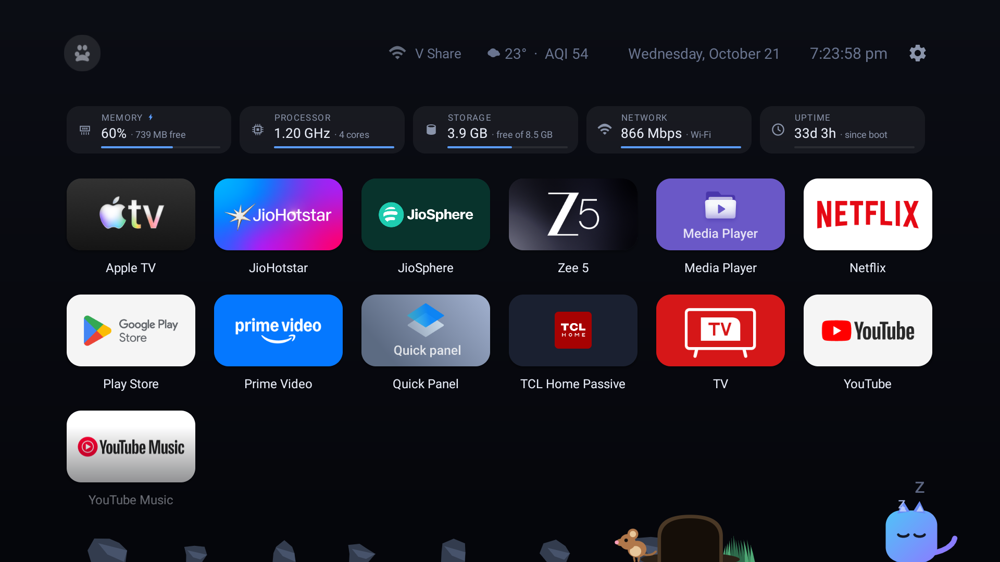
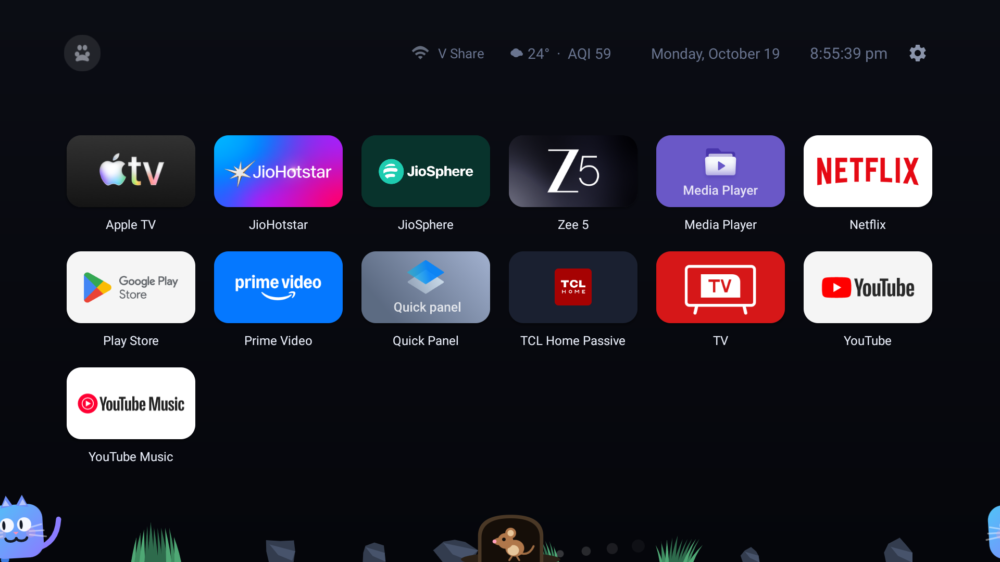
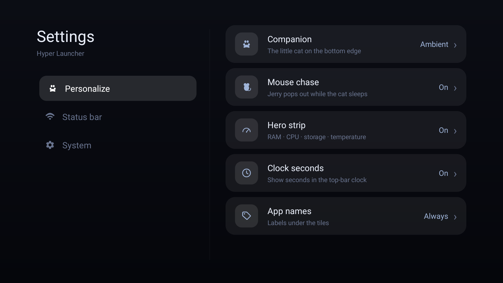
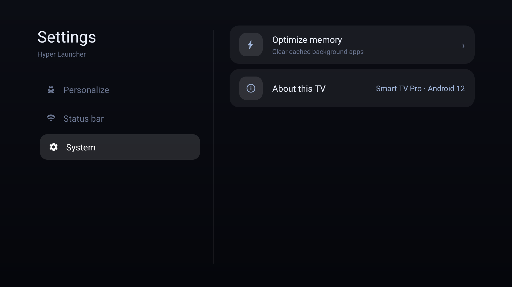
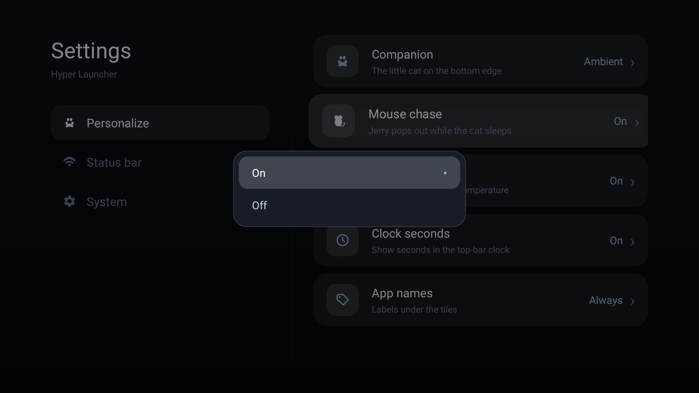
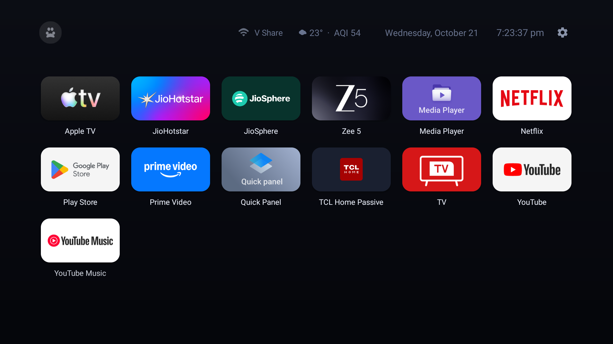

<div align="center">


# Hyper Home TV

**A fast, minimal, privacy-first launcher for Android TV — with a companion cat.**

<p>
  <a href="../../releases/latest"></a>
  <a href="LICENSE"></a>
  
  
  
</p>

<p>
  <a href="#features">Features</a> ·
  <a href="#screenshots">Screenshots</a> ·
  <a href="#install-on-your-tv">Install</a> ·
  <a href="#privacy">Privacy</a> ·
  <a href="#build-from-source">Build</a>
</p>



</div>

---

Stock TV launchers are billboards — rows of ads, sponsored "channels", and recommendations you never asked for. Hyper Home TV is the opposite: **a calm grid of your apps**, a glanceable row of live system stats, and a little cat who lives at the bottom of the screen and occasionally chases a mouse through it.

No account. No ads. No tracking. No analytics. Everything runs on-device.

## Features

<table>
<tr>
<td width="50%" valign="top">

### Launcher

- **DPAD-first app grid** — big readable tiles, smooth focus zoom, instant navigation
- **Organize your way** — long-press to reorder, hide, uninstall, or jump to app info
- **Everything configurable** — companion, stats strip, labels, clock seconds, status chips

</td>
<td width="50%" valign="top">

### System strip

- **Live stats** — memory, CPU clock, storage, network link speed, uptime
- **One-tap optimize** — the memory chip sweeps cached background apps and reports what it freed
- **Honest fallbacks** — adapts to whatever your device actually exposes (thermal zones, `/proc/stat`, cpufreq)

</td>
</tr>
<tr>
<td width="50%" valign="top">

### Companion cat

- **A living resident** — breathes, blinks, naps along the bottom edge
- **The chase** — while it sleeps, a mouse pops out of a hole; the cat wakes with a startled `!` and gives chase
- **Seamless edges** — both characters wrap off one side of the screen and out the other, like the cartoons
- **Fully optional** — companion and mouse chase are independent settings

</td>
<td width="50%" valign="top">

### Experience

- **PS5-style settings** — split-pane categories, live previews, staggered animations
- **Top bar** — clock with optional seconds, date, Wi-Fi chip, opt-in weather + AQI
- **Edge fades** — tiles dissolve into the floor near the companion zone instead of colliding with it

</td>
</tr>
</table>

## Screenshots

<div align="center">

<p><i>The chase — the mouse dives for its hole while the cat wraps around the screen edge.</i></p>
</div>

<table>
<tr>
<td width="50%"></td>
<td width="50%"></td>
</tr>
<tr>
<td align="center"><i>Split-pane settings, PS5-style</i></td>
<td align="center"><i>System category with optimize + about</i></td>
</tr>
<tr>
<td></td>
<td></td>
</tr>
<tr>
<td align="center"><i>In-place option pickers</i></td>
<td align="center"><i>Everything off — just the grid</i></td>
</tr>
</table>

## Install on your TV

**1. Download** the signed APK from the [latest release](../../releases/latest).

**2. Enable** unknown sources on the TV: `Settings → Security → Install unknown apps`.

**3. Install** — either sideload via a file manager, or over ADB:

```sh
adb connect <tv-ip>:5555
adb -s <tv-ip>:5555 install hyper-launcher.apk
```

**4. Make it home** — system `Settings → Apps → Default apps → Home app`, or:

```sh
adb -s <tv-ip>:5555 shell cmd package set-home-activity dev.hyper.launcher/.HomeActivity
```

**Rollback** — re-enable your stock launcher any time (TCL/Google TV example):

```sh
adb -s <tv-ip>:5555 shell pm enable com.google.android.apps.tv.launcherx
adb -s <tv-ip>:5555 shell cmd package set-home-activity com.google.android.apps.tv.launcherx
```

> Requires Android TV / Google TV, Android 8.0+ (minSdk 26). Tested on a TCL Google TV (Realtek).

## Privacy

Hyper Home TV runs **entirely on your device**. No telemetry, no crash reporting, no analytics SDKs, no ads, nothing to sign into.

The **only** network request it can ever make is the opt-in weather chip: an anonymous query to [Open-Meteo](https://open-meteo.com) (no API key, no account) plus a coarse IP-geolocation lookup to pick your city. Disable the chip and the app never touches the network.

| Permission | Why it's needed |
|---|---|
| `INTERNET` | Opt-in weather chip only |
| `ACCESS_NETWORK_STATE` / `ACCESS_WIFI_STATE` | Wi-Fi chip and link-speed display |
| `ACCESS_FINE_LOCATION` | Android 12+ requires it just to read the connected SSID — never used for location |
| `REQUEST_DELETE_PACKAGES` | Uninstall option in the app context menu |
| `KILL_BACKGROUND_PROCESSES` | The memory optimize action |

## Build from source

```sh
cd hyper-launcher
gradle assembleDebug      # → app/build/outputs/apk/debug/
```

For a signed release, drop a `keystore.properties` next to `settings.gradle`:

```properties
storeFile=hyper-release.keystore
storePassword=…
keyAlias=hyper
keyPassword=…
```

then `gradle assembleRelease`. Pure Java + framework APIs — no AndroidX, no third-party dependencies.

## Companion tool: `web/`

A read-only ADB dashboard (single `python3` file, zero dependencies) that visualizes every package on the TV — tagged remove / optional / critical — plus device info and live focus. Handy for debloating TCL/Realtek sets.

```sh
python3 web/server.py <tv-ip>:5555   # → http://localhost:8787
```

## Contributing

Issues and PRs welcome. The codebase is intentionally simple — plain Java views, no frameworks — so keep dependencies at zero unless there's a very good reason.

## License

[MIT](LICENSE) © Dinesh K N
